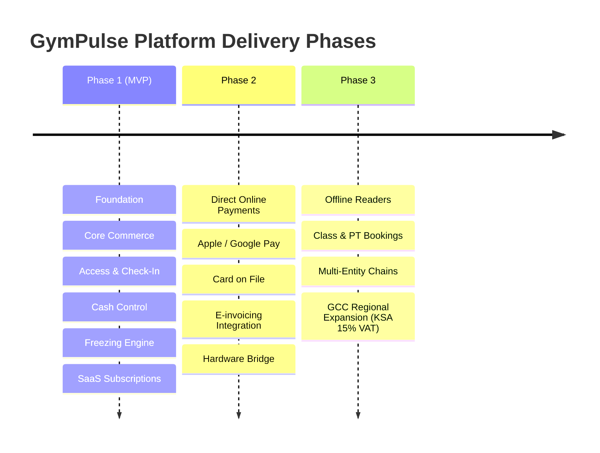

# GymPulse Platform — Phases and Milestones Roadmap

> **Tracking Document:** Tracks progress through Phase 1 (MVP) and future phases as defined in the **GymPulse Platform Specification** (Section 1.2 & Section 15.1).

---

## 🗺️ High-Level Project Phases

---

## 📌 Phase 1: MVP Detailed Milestones

### Milestone 1: Architectural Foundation
**Status: ✅ COMPLETED**

*Objective: Establish monorepo structure, core database schema for all 22+ tables, multi-tenant isolation, cryptographic audit logging, and mathematical calculation engines.*

- [x] **Monorepo Setup:** `pnpm` workspaces (`apps/api`, `apps/web`, `packages/shared`).
- [x] **Database Schema:** Full Drizzle ORM definitions for all 22+ specification tables (`gyms`, `branches`, `users`, `members`, `plans`, `memberships`, `freezes`, `payments`, `invoices`, `shifts`, `audit_logs`, etc.).
- [x] **PostgreSQL Infrastructure:** Migration `0000_core_setup.sql` with `btree_gist`, `pg_trgm`, RLS policies, append-only triggers, and exclusion constraints.
- [x] **Three-Layer Tenant Isolation:**
  - Layer 1: NestJS `TenantGuard` extracting gym/branch context from JWT assignments.
  - Layer 2: `TenantRepository` enforcing `WHERE gym_id = :gymId`.
  - Layer 3: Database RLS `set_config('app.gym_id', ..., true)` session variable backstop.
- [x] **Security & Auth:** Argon2id password hashing, RFC 6238 TOTP MFA, 30-day rotating refresh tokens with reuse detection, and member phone OTP schema.
- [x] **Tamper-Evident Audit Chain:** Append-only trigger with SHA-256 hash chains (`sha256(prev_hash || canonical_row)`).
- [x] **Core Utility Engines:**
  - UAE VAT integer math engine (5% VAT in fils, `round_half_up`, 500 bps).
  - Freeze date mathematics & quota engine.
- [x] **Interactive Web Shell:** React + Vite + Tailwind CSS dashboard with full **Bilingual (English / Arabic RTL)** support and live simulators.

---

### Milestone 2: Core Commerce
**Status: 🔄 NEXT IN QUEUE**

*Objective: Deliver member registration, plan management, prepaid membership terms, date adjustment ledgers, front desk payments, and gapless sequential invoicing.*

- [ ] **Members Management:**
  - `POST /v1/members`: Register new member with unique member number per gym.
  - `GET /v1/members`: List and filter members with pagination.
  - `GET /v1/members/:id`: Member details with active memberships and invoices.
  - `PATCH /v1/members/:id`: Update personal details & emergency contacts.
- [ ] **Plans Management:**
  - `POST /v1/plans`: Create plans (day/month durations, price in fils, grace days, branch access).
  - `GET /v1/plans`: List active plans per gym.
  - `PATCH /v1/plans/:id`: Update plan settings without affecting existing memberships (`plan_snapshot`).
- [ ] **Prepaid Memberships:**
  - `POST /v1/memberships`: Purchase membership term with inclusive end-date math (`start_date + duration - 1 day`).
  - `POST /v1/memberships/:id/renew`: On-time vs late renewal rules (continuation vs payment date start).
  - `POST /v1/memberships/:id/adjustments`: Date adjustment ledger (`purchase`, `renewal`, `complimentary`, `correction` with mandatory reason).
- [ ] **Desk Payments (Cash, POS, Bank Transfer):**
  - Verify active cashier shift (`SHIFT_NOT_OPEN` if no shift open).
  - Atomic transaction: insert payment (succeeded) + insert membership/adjustment + create invoice + outbox event.
- [ ] **Gapless Invoicing Engine:**
  - Atomic row-locking sequential counters (`invoice_counters` per gym and series `INV`/`CN`).
  - Generation of `tax_invoice` (with gym TRN), `simplified_tax_invoice`, or `receipt` (non-VAT).
  - Structured bilingual invoice line items in fils.
- [ ] **Frontend Deliverables:**
  - Member registration and profile views.
  - Plan catalog configuration.
  - Front desk checkout flow (membership sale & renewal).
  - Printable / downloadable bilingual invoice view.
- [ ] **Testing Criteria:**
  - Integration tests for gapless invoice numbering under concurrent requests.
  - Date ledger integrity tests (all date modifications have corresponding ledger entry).
  - Complimentary adjustment reason enforcement.

---

### Milestone 3: Access & Check-In
**Status: ⏳ SCHEDULED**

*Objective: Secure physical and desk access control with Ed25519 dynamic pass tokens, single-use replay protection, fast trigram desk search, and real-time WebSocket alerts.*

- [ ] **Dynamic Pass Token Engine:**
  - `POST /v1/me/pass-token`: Issues Ed25519-signed token with 45-second TTL and unique `jti`.
  - Server-side signature & expiry verification.
  - Anti-replay check using unlogged PostgreSQL `used_pass_tokens` table.
- [ ] **Computed Access Decision Algorithm (Section 6.2):**
  - Settle due freezes idempotently.
  - Active freeze check -> deny with `frozen`.
  - Date validity + grace period check -> allow (flag grace) or deny (`expired`).
  - Branch and time schedule verification.
  - Log every decision to `check_ins`.
- [ ] **Real-Time Desk Scanner & Alerts:**
  - Socket.IO gateway (`apps/api`) with branch-isolated rooms.
  - Instant desk audio-visual banner: Green (allowed), Amber (grace/frozen), Red (denied).
- [ ] **Ctrl+K Trigram Search:**
  - `GET /v1/members/search`: Server-side trigram search across normalized names, phones, and member numbers.
  - Manual check-in modal with required reason logging (`desk_search`).
- [ ] **Testing Criteria:**
  - Token replay test (same token rejected on second scan).
  - Expired and frozen member access rejection tests.
  - Desk search performance test (< 300ms p95).

---

### Milestone 4: Cash Control & Shift Audit
**Status: ⏳ SCHEDULED**

*Objective: Enforce cashier financial accountability, blind closeouts, variance approval workflows, and automated anomaly reports.*

- [ ] **Cashier Shift Lifecycle:**
  - `POST /v1/shifts`: Open shift with mandatory `opening_float_minor`.
  - Shift association on every cash/POS transaction.
- [ ] **Blind Closeout Workflow:**
  - `POST /v1/shifts/:id/closeout`: Cashier submits blind count of cash and terminal slips.
  - Server computes variance against recorded ledger totals.
- [ ] **Variance Approval Workflow:**
  - `POST /v1/shifts/:id/approve`: Manager/Owner approval for variances exceeding gym tolerance.
- [ ] **Cash Control & Anomaly Reports:**
  - `GET /v1/reports/anomalies`: Anomaly detection per staff member (complimentary extensions, voids, overrides, closeout variances).
- [ ] **Testing Criteria:**
  - Closed shift payment rejection test.
  - Blind count variance calculation test.
  - Hash chain integrity verification for shift audit entries.

---

### Milestone 5: Freezing Engine
**Status: ⏳ SCHEDULED**

*Objective: Implement the full 10-step eligibility engine, member self-service requests, proof upload workflows, hourly sweep jobs, and front-desk PIN overrides.*

- [ ] **10-Step Eligibility Validator:**
  - `GET /v1/memberships/:id/freeze-eligibility`: Live check of occurrences and remaining quota.
  - `POST /v1/memberships/:id/freezes/preview`: Date math preview (projected end date, minimum days charge).
- [ ] **Freeze Request & Review Workflow:**
  - `POST /v1/memberships/:id/freezes`: Submit freeze request with policy snapshot.
  - `POST /v1/freezes/:id/approve` and `reject`: Manager approval for reviews/proof requirements.
  - `POST /v1/freezes/:id/cancel`: Member/staff cancellation returning quota.
- [ ] **Early Lift & Desk PIN Handling:**
  - `POST /v1/freezes/:id/lift`: Early lift date math (`min(N, max(days_used, min_days))`).
  - Desk override modal with Manager PIN step-up.
- [ ] **Background Sweeps (`pg-boss`):**
  - Hourly `gym-day-sweep`: Activate due freezes, complete ended freezes, and update date ledgers.
- [ ] **Testing Criteria:**
  - PostgreSQL exclusion constraint test (no overlapping or adjacent freezes).
  - Quota settlement unit and property-based tests (`fast-check`).
  - Timezone-aware sweep execution test.

---

### Milestone 6: Subscriptions & Production Launch
**Status: ⏳ SCHEDULED**

*Objective: Complete GymPulse SaaS subscription billing, outbox notifications, system reporting, and end-to-end launch verification.*

- [ ] **GymPulse SaaS Billing:**
  - `saas_plans` and `gym_subscriptions` management.
  - Gapless platform invoicing (`platform_invoices`).
  - Dunning state machine: `active` -> `past_due` -> `restricted` -> `suspended`.
- [ ] **Transactional Outbox Engine:**
  - `notification_outbox` processing with exponential backoff and dead-letter queue.
  - Push, WhatsApp, SMS, and Email delivery abstractions.
- [ ] **Executive Reporting:**
  - Revenue breakdown, check-in heatmaps, manual adjustment logs.
- [ ] **Pilot Verification & Penetration Testing:**
  - OWASP ASVS Level 2 security verification.
  - Load testing check-in endpoints (peak 50 scans/min per branch).

---

## 🚀 Phase 2 & Phase 3 Roadmap (Post-MVP)

### Phase 2: Direct Online Payments & Connected Accounts
- Provider connected account onboarding (Stripe Connect / Tap Payments direct charge model).
- In-app member purchases with Apple Pay & Google Pay.
- Automated subscription collection & dunning for gyms.
- Member auto-renew with card on file.
- UAE FTA accredited e-invoicing provider integration.
- Apple Wallet and Google Wallet passes.
- On-premise hardware bridge agent for turnstiles (ZKTeco, Hikvision).
- Redis cache & message broker for multi-instance scaling.

### Phase 3: Hardware Integration & GCC Expansion
- Offline-capable reader controllers verifying Ed25519 tokens offline.
- Class bookings, PT schedules, and resource management.
- Multi-entity corporate gym groups.
- GCC localization (Saudi Arabia ZATCA Phase 2 e-invoicing & 15% VAT).
